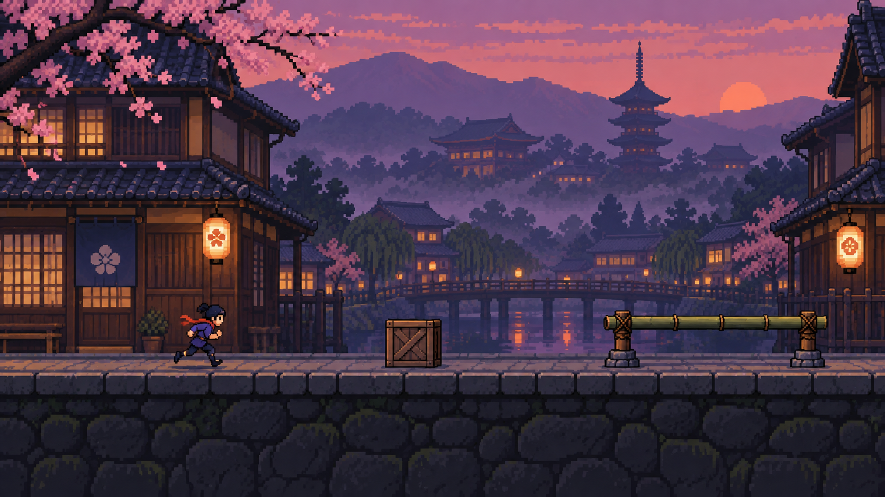

> Implementation update: the user later requested immediate actions, live game speed control, and distance-only scoring. The current behavior is documented in [LANTERN_RUN.md](LANTERN_RUN.md); timing and per-action rewards below describe the original plan.

# Jev / Lantern Run

Planning draft — 2026-09-23. No game implementation yet.

Art direction generated with the built-in image tool. [Generation prompt](concepts/lantern-run-prompt.txt).

## Agreed direction

A continuous, real-time 2D auto-runner through Kyoto at dusk, drawn in crisp pixel art.
Obstacles are generated randomly as the runner moves; the course is not a scripted
obstacle sequence. Jev chooses between `jump`, `duck`, and `stand` from text descriptions
of the game state.
`stand` means continuing to run upright, not stopping. Staying upright earns the most
points when it is safe. The world keeps moving while an API request is pending.

The runner becomes a separate view in the existing demo, alongside Jira triage. Keep
the interface quiet: a large game scene, score, three hearts, the current action, and
estimated API cost. Developer details are expandable.

## Why it is a useful demo

This makes a structured model choice visible: observe the scene, choose a discrete
action, and see the physical consequence. It tests interpreting text state, applying
rules, choosing a safe high-reward action, and meeting a deadline.

It is not a vision benchmark: the game renders images for the viewer, but Jev receives
only text and numeric state. Reward is an application scoring rule described in the
prompt. It does not train or update Jev's weights during play.

## Scope and alternatives

| Approach | Benefit | Tradeoff | Decision |
| --- | --- | --- | --- |
| Continuous runner with advance decisions | Feels like a real game and exposes response deadlines | Must distinguish wrong decisions from late responses | Selected by the user |
| Pause at each obstacle | Easier to explain individual decisions | Does not demonstrate continuous control | Not the default; only a future explicit inspection mode |
| React with a Canvas renderer and Python simulation | Fits the current stack and keeps rules in Python | Small amount of custom rendering/animation work | Recommended for this small three-action game |
| Browser game engine with its own physics | Useful for a larger platformer | Adds a second rules implementation and more integration work | Reconsider if scope expands |

## First playable course

- One side-scrolling lane, automatic forward movement, three actions, and three lives.
- An endless-style procedural course, with a 60-second presentation round or game over
  after three collisions. Generate the next encounter during play instead of loading a
  curated sequence. A seed allows replay but does not prescribe a handcrafted course.
- Clear stretches reward upright running; ground obstacles require jumping; overhead
  obstacles require ducking. Add gaps only after the first obstacle set is verified.
- Randomize encounter type, width, clearance and spacing, including some harmless objects
  whose height or position makes avoidance unnecessary.
- Each encounter has at least one safe action. The Python simulator rejects impossible
  sequences, insufficient jump clearance, duck durations that expire too early, and
  encounters that begin before the runner has recovered from the previous action.
- A new run uses a fresh seed; replay repeats the previous one. Manual play uses the
  same course and rules, with up/space for jump, down for duck, and upright as neutral.

The first version chooses the action; deterministic game code schedules its animation.
It does not ask Jev to issue frame-by-frame inputs or discover a millisecond-perfect
jump start. A later timing challenge could expand that task explicitly.

## Reward rules

| Outcome at the end of an encounter | Score |
| --- | ---: |
| Clear safely while upright | +10 |
| Clear safely with a jump or duck | +4 |
| Collision | −25 and one lost life |
| No valid decision before the deadline | No action bonus; any collision still applies |

Award points once per completed encounter, never per animation frame or API wait.
Jumping unnecessarily on a clear section remains safe but earns less than standing.
Standing into a barrier loses points and a life. The course deliberately includes
enough ground and overhead obstacles that always standing, always jumping, and always
ducking all perform poorly. Do not add a survival-per-second bonus that rewards waiting.

Use adjustable generation weights, initially around 40% clear stretches, 30% ground
obstacles and 30% overhead obstacles. These are probabilities, not a fixed count or
order. The scene generator emits geometry; only the private evaluator determines
which action is optimal. Tune the weights if a fixed-action baseline exploits the game.

## Continuous decision timing

Let T be the fixed action trigger for the next encounter, before obstacle contact.

| Time | Event |
| --- | --- |
| T − 1.50 seconds | Capture a state snapshot and send one asynchronous Jev request |
| T − 0.15 seconds | Close the decision window and lock a valid response |
| T | Start the chosen jump, duck, or upright movement |
| After clearance | Resolve collision, award points, and store the decision trace |

The initial response budget is 1.35 seconds, including network and validation. This is
a starting game setting to validate, not a promised API latency. Do not change it
silently during a scored run. Random spacing starts at a safe minimum of around three
seconds between triggers, giving the runner time to recover before the next observation;
validate the exact minimum against the action geometry. Randomness changes the course,
not the minimum reaction window.

Python owns a monotonic clock, run ID, encounter ID, and deadlines. Accept a response
only when its IDs match and it arrives before the cutoff. Cancel pending work at the
cutoff and discard stale responses. Cancellation cannot undo provider work already
received or guarantee it is not billed.

No pause, slow motion, rule-based rescue, or late-action correction is hidden in the
run. Without a valid response, the runner continues in its current natural state
(upright under the recovery invariant). Show a small deadline-missed indicator. A
surviving clear encounter with no response is not credited as a successful Jev choice.

API errors, invalid answers, late answers, and valid-but-wrong answers remain distinct.
If the tab is hidden, connection is lost, or a severe presentation stall prevents fair
play, mark the run interrupted rather than quietly resuming past missed encounters.

## Jev input and output

Start with **Choice**, which directly returns a selected action, its distribution,
and confidence. Do not force unrelated primitives into the main game.

Send a compact server-generated text/JSON snapshot containing:

- Runner posture, dimensions, forward speed, and action recovery status.
- Upcoming obstacle bounds, width, distance to the action trigger, and distance to
  collision; include all geometry needed during the action's duration.
- Fixed jump trajectory and duck duration/height, expressed consistently with the
  physics rules; world coordinates and units must be explicit.
- The scoring rules and the objective: choose the highest-reward safe action.

The available labels are exactly `jump`, `duck`, and `stand`. Describe their effects
in the Choice criteria. Do not include `correct_action`, a precomputed list of safe
moves, reward for each hypothetical move, or obstacle names such as `must_duck`.

The inspector shows the actual input, raw Choice output, accepted action, deadline
outcome, and simulator result. Probability bars describe model preference; they are
not a claimed probability of surviving the obstacle.

A later optional Noul question could ask whether remaining upright is safe, using the
same snapshot. Questions in one Jev request are independent: it cannot verify “the
action Choice selected” unless that choice is provided in a subsequent request.

## Evaluation

The deterministic simulator privately tries all three actions to establish which are
safe and which maximize reward. It is an evaluator only, never a hidden controller.

Use identical seeds, difficulty, deadlines, and a pinned resolved model when comparing:

- Jev versus always-upright and simple fixed-action baselines.
- Jev versus the simulator's best possible policy for the supplied information.
- Different prompt versions, keeping a held-out set of encounter geometries.

Show score and lives during play. Put detail in the end-of-run report:

- Optimal decisions among timely valid replies.
- Optimal timely decisions among every encounter actually presented.
- Safe-but-unnecessary actions, collisions, deadline misses, and API failures.
- Action breakdown, returned token usage, and estimated cost of reported usage.
- Actual round-trip latency distribution in the developer inspector.

Never exclude slow responses from the overall success rate without showing their count.
Do not count future encounters after game over as completed. Distinguish cost estimated
from returned usage from a final bill, especially if requests fail or are cancelled.

## Kyoto-at-dusk visual direction

- Crisp low-resolution artwork, drawn at 640×360 logical pixels and scaled with nearest
  neighbor rendering. Interface labels remain sharp and readable outside the pixel grid.
- Indigo and plum sky, amber lanterns, warm stone, and a restrained vermilion accent.
- A small courier in an indigo jacket and short red scarf; readable upright, jump, duck,
  and stumble silhouettes. No weapons or combat systems.
- Three restrained parallax layers: distant hills/temple roofs, wooden machiya facades,
  and the playable stone path. Collidable obstacles have stronger contrast than scenery.
- Quiet lantern flicker and a few petals, kept away from obstacle silhouettes. Reduced
  effects mode removes decorative motion without changing collision rules.
- No text-heavy dashboard, fabricated live numbers, ornamental pseudo-Japanese writing,
  or status panels covering the course.
- Optional soft ambience and footstep/jump sounds, muted initially with a clear toggle.

The concept frame illustrates art direction only. Production work still needs separate
background layers, obstacle sprites, and consistent animation frames; do not slice the
concept image into supposedly ready game assets.

## Implementation plan

**Decision proof first.** Define a constrained random generator, action envelopes and
reward rules in Python. Sample a small set of generated states and label them with the
private collision simulator. Run live Choice calls against those snapshots and
measure action quality and deadline misses before investing in animation polish.

**Playable local runner.** Implement a deterministic Python world at a fixed simulation
step, stream timestamped snapshots/events over FastAPI WebSockets, and render with
React/Canvas interpolation. Keep simulation and network calls asynchronous so requests
never block movement. Manual play verifies collision boxes and scoring.

**Live Jev control.** Add the snapshot scheduler, one request per encounter, deadline
handling, replay log, and real cost accounting. Reuse the existing HTTP connection
pool, safe error handling, Choice/usage validation, and pricing helper; give the runner
its own action response schema instead of applying Jira routing policy to game outputs.

**Art and review.** Build coherent pixel assets, animation states and parallax. Review
desktop and narrow-screen layouts, input accessibility, real-time pacing, and failures.
Finish with fresh random runs and one-click seed replay for presentations.

Suggested modules: `backend/jev_demo/runner/` for typed state, simulation, scoring and
Jev scheduling; `frontend/src/runner/` for the Canvas scene, controls and inspector.
Integrate behind a separate Runner navigation item; preserve the Jira workbench.

## Acceptance checks

- The simulation advances during a delayed model request.
- Obstacles are generated during play, vary across seeds, and replay identically from
  the same seed without violating the spacing and collision constraints.
- Ground/overhead/clear encounters produce distinct optimal actions.
- Upright earns the largest safe reward; repeated inputs cannot duplicate bonuses.
- A response arriving after cutoff or from an old run cannot move the player.
- No fallback heuristic produces a result labeled as Jev's decision.
- Replay and reference policy agree on geometry and collision outcomes.
- Errors and interruptions are visible, with no invented success or cost values.
- The scene remains legible on desktop and mobile; pixel scaling does not blur sprites.

## Official references

- [Choice output and criteria](https://docs.typesafe.ai/primitives/choice)
- [Text-only input, model versions and current pricing](https://docs.typesafe.ai/models)
- [API request/response schema](https://docs.typesafe.ai/api)
