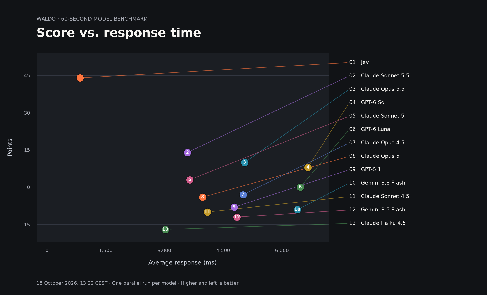
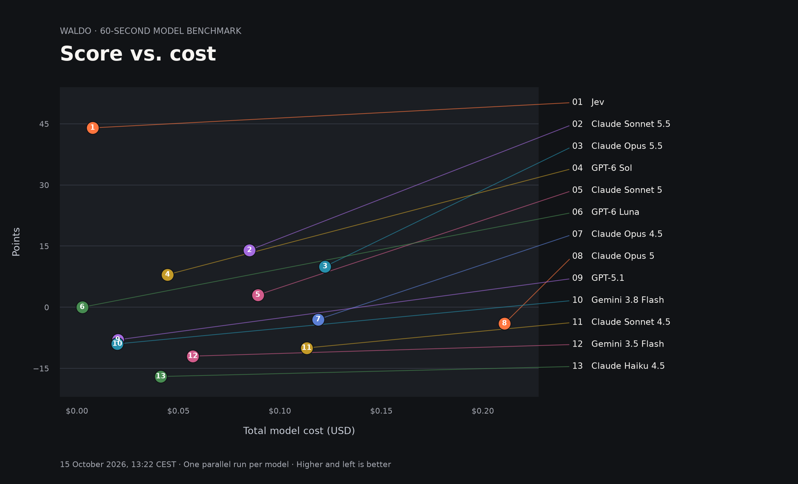

# Waldo model benchmarks

Measured **15 October 2026, 13:22 CEST**: **13 of 15 models** returned results. One **60-second** run per model, launched in parallel on the same shuffled course. No completed measurement for Gemini 3 Pro, Gemini 2.5 Pro; their recorded errors remain in the raw data, without invented scores or chart points.

| Model | Points | Accuracy | Avg. response | Cost | Calls |
| --- | ---: | ---: | ---: | ---: | ---: |
| **Jev** | **44** | 98% | 843 ms | $0.007696 | 47 |
| **Claude Sonnet 5.5** | **14** | 100% | 3,590 ms | $0.085044 | 15 |
| **Claude Opus 5.5** | **10** | 100% | 5,049 ms | $0.122255 | 11 |
| **GPT-6 Sol** | **8** | 100% | 6,663 ms | $0.044662 | 9 |
| **Claude Sonnet 5** | **3** | 60% | 3,650 ms | $0.089093 | 16 |
| **GPT-6 Luna** | **0** | 50% | 6,468 ms | $0.002582 | 9 |
| **Claude Opus 4.5** | **-3** | 36% | 5,007 ms | $0.118866 | 12 |
| **Claude Opus 5** | **-4** | 36% | 3,976 ms | $0.210657 | 15 |
| **GPT-5.1** | **-8** | 17% | 4,782 ms | $0.020134 | 13 |
| **Gemini 3.8 Flash** | **-9** | 0% | 6,395 ms | $0.019883 | 10 |
| **Claude Sonnet 4.5** | **-10** | 14% | 4,098 ms | $0.113145 | 15 |
| **Gemini 3.5 Flash** | **-12** | 0% | 4,856 ms | $0.057090 | 13 |
| **Claude Haiku 4.5** | **-17** | 5% | 3,024 ms | $0.041272 | 20 |
| Gemini 3 Pro | — | Unavailable | — | Unknown | 1 |
| Gemini 2.5 Pro | — | Unavailable | — | Unknown | 1 |





## Method

- Score: +1 for a correct box, −1 for a miss or malformed box. Late answers earn no points.
- All models start together, with one in-flight request per model. No hidden retries.
- The same 60 generated images, course seed `1957722798`, and scoring fingerprint
  `37020db14fc917ec` apply to every model.
- Fast models reach more images. A correct answer has the same 450 ms feedback pause as the
  game; a miss advances immediately.
- Models see the same unmarked JPEG bytes without reference coordinates or position hints. Jev
  uses its native box question; gateway models use the game's JSON box prompt and 256-token
  output limit.
- Average response time includes all returned requests, including the last answer after the
  cutoff. Cost includes its returned billing too, unlike a live game that may cancel an
  outstanding call.
- Gateway-reported cost is preferred; token-based list pricing is the fallback. Jev uses $0.042
  per million input tokens. Failed calls with no billing information have unknown cost.
- One run per model is a demonstration snapshot, not a general capability ranking. Parallel
  load, gateway routing, caching, network latency, and model output-format compliance affect
  these numbers.
- These results are separate from player history; no synthetic human scores are added to the
  leaderboard.

## Reproduce

```sh
uv run python -m jev_demo.waldo_benchmarks
uv run python scripts/export_waldo_benchmarks.py
```

The first command makes paid requests using the ignored `.env` and replaces the snapshot.
The second only regenerates these tables and charts. Opening **Show full model benchmarks**
in the app is read-only and never starts model calls.

[Raw measured data](../../backend/jev_demo/assets/waldo/full-benchmarks.json)
