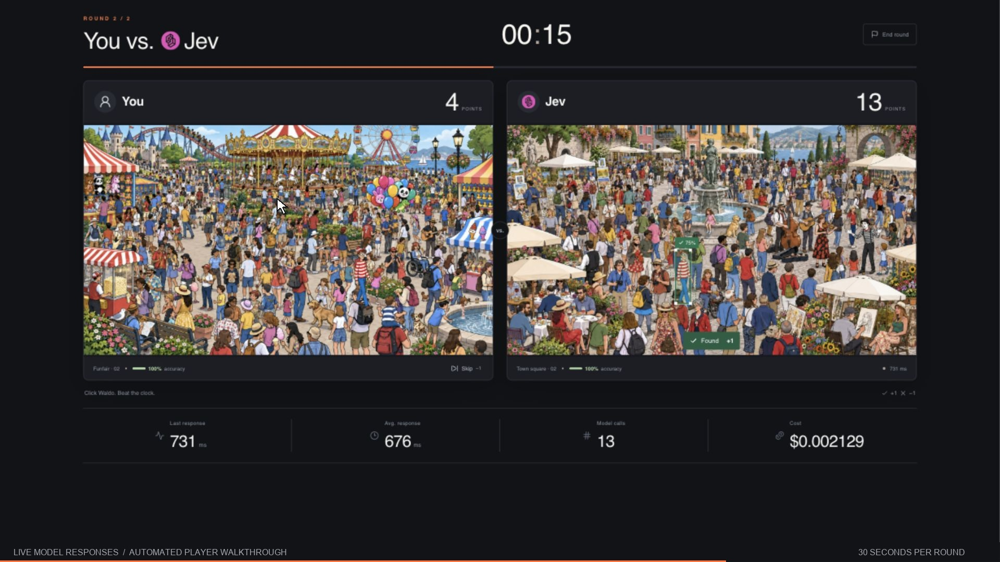

# Game mode walkthrough

[Watch the MP4](https://github.com/flucas96/demo_jev/raw/refs/heads/main/docs/demo/waldo-game-demo.mp4)

The presentation mode at `/waldo/presentation`, recorded on 15 October 2026.
Each round lasts **30 seconds**. The full video lasts about **90 seconds**, including
setup, countdowns, the transition, and results.

| Time | On screen |
| --- | --- |
| 0–7 s | Choose an opponent and explicitly start round 1 |
| 7–43 s | Countdown, then the 30-second Claude Opus 5.5 round |
| 43–50 s | Scroll to Jev, explicitly start round 2, and count down |
| 50–80 s | The 30-second Jev round |
| 80–90 s | Final leaderboard, costs, and the Accuracy chart toggle |

Both models make real API calls on the same image sequence. The displayed model boxes,
scores, timing, and costs come from the application. No model answers are staged.
Player clicks are automated using the local reference annotations to demonstrate the
interaction; the player scores are not human benchmark measurements. The recording has
a rendered pointer and click feedback, with idle recording setup trimmed between scenes.
Gameplay runs at its original pace. This walkthrough is separate from the
[60-second full-model benchmark](../benchmarks/README.md).

Delivery: **1920 × 1080**, **30 fps**, **H.264 / yuv420p**, MP4 with fast start,
approximately **8.5 MB**, silent. The still preview is `waldo-game-poster.jpg`.
The app's default duration remains 60 seconds; set **Time per round** to 30 to replay this demo.
